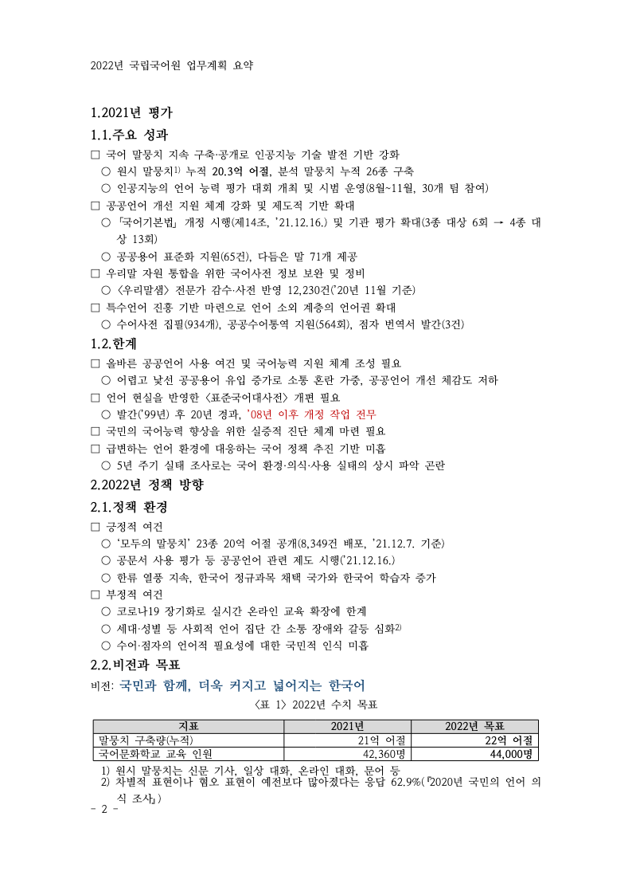

# 공공 자료 요약 보고서 예제 — 「2022년 국립국어원 업무계획 요약 보고」

Default 라우트로 35쪽짜리 공공 업무계획을 4쪽 개조식 요약 보고서로 만든 예제입니다. 0.1.8~0.1.13 에서 더한
블록을 실제 문서 하나에 함께 썼습니다.

| 쓴 기능 | 위치 |
|---|---|
| 목차(`toc`, 개요 번호·쪽 번호) + 쪽 나눔 | 1쪽 |
| 목록(`list`, □ ○ 단계·내어쓰기), 항목 강조·각주 | 2~4쪽 |
| 표 캡션 자동 번호(`<표 {n}>`), 제목 행, 열 폭 비율, 셀 강조 | <표 1>, <표 2> |
| 셀 병합(`merges`) — 3대 전략 칸 | <표 2> |
| 그림(`image`) + 캡션 자동 번호 — 자료 수치로 그린 그래프 | <그림 1> |
| 글자 강조(굵게·색·크기), 머리말, 꼬리말 쪽 번호 | 전체 |



| 파일 | 내용 | SHA-256 |
|---|---|---|
| `doc_spec.md`, `spec_lock.json`, `outline.json` | 기획 (독자·분량·장 구성·확인 필요 사항, `gaejosik`, 최대 6쪽) | |
| `units/U01–U04.json` | 장별 HDS 원고 | |
| `sources/task_budget.png` | 과제별 예산 그래프 — 원문 수치로 그림(`sources/make_chart.py`, Pillow + Noto Sans KR) | |
| `plan_summary.hwpx` | 결과 HWPX (4쪽, 표 2개, 그림 1개, 각주 2개) | `2ace74aedd4f31538bd199b8e5ed3109e1a039523ac571cf63c613ddd2a0c7db` |
| `hancom/plan_summary-2024.pdf` | 같은 HWPX 를 한컴오피스 2024 로 Print 출력 (4쪽) | `eb73674d65f0cf1e99638ffe1d14e6bcfd27229da76c32fbe367ba63ad83f3d1` |
| `tsv/plan_summary_native_silhouette.tsv` | rhwp 출력과 한컴 PDF 의 쪽별 실루엣 일치율 (99.99 / 97.61 / 98.05 / 97.96%) | |
| `png/page1–4.png` | rhwp 미리보기 | |

근거 자료는 rhwp 저장소의 공개 샘플 `samples/2022년 국립국어원 업무계획.hwp`(35쪽)입니다. 이 폴더에는 넣지 않았고,
빌드에는 단위 원고와 그래프 그림만 쓰입니다. 원문에 없는 수치는 쓰지 않았고, 원문에서 확인되지 않는 값(6번 과제
합계 예산)은 표에 "원문 미기재"로 두었습니다.

## 재현

rhwp `devel` `ea86816b`(0.9.0) 에서 같은 원고는 같은 바이트의 HWPX 를 만듭니다(2026-11-03 확인).

```bash
P=$(python3 skills/hwp-master/scripts/project_manager.py init plan-demo | tail -1)
cp examples/plan_summary/{doc_spec.md,outline.json,spec_lock.json} $P/
cp examples/plan_summary/units/*.json $P/units/
cp examples/plan_summary/sources/task_budget.png $P/sources/
python3 skills/hwp-master/scripts/build.py $P
shasum -a 256 $P/exports/*.hwpx      # Linux 는 sha256sum
```

## 이 예제를 만들며 고친 것

- **한컴에서 표가 각주와 겹침.** rhwp scaffold 표가 "쪽 영역 안으로 제한" 없이 저장돼, 한컴이 2쪽 끝 <표 1>의
  마지막 행을 각주 위에 겹쳐 그렸습니다. 빌드가 모든 표에 이 속성을 켜도록 고쳐, 지금은 한컴과 rhwp 모두 마지막
  행을 제목 행과 함께 3쪽으로 넘깁니다(수정 전 3·4쪽 일치율 38%·46% → 98%).
- **셀 넘침 경고(W201)가 셀 안쪽 여백을 작게 잡음.** "언어자원 더 크게"가 두 줄로 꺾이는데도 경고가 없었습니다.
  여백을 scaffold 값(좌우 1.8mm)으로 고친 뒤 경고에 따라 열 비율을 `[2.3, 6.1, 1.6]`으로 바꿨습니다.

## 한컴 출력과 다른 점

목차의 쪽 번호 11개는 한컴 PDF 의 실제 제목 쪽과 모두 같습니다. 남은 차이는 장 제목 번호 뒤 간격(rhwp 미리보기는
붙여 그림, [edwardkim/rhwp#8433](https://github.com/edwardkim/rhwp/pull/8433))과 미리보기 대체 글꼴의 글자 폭입니다.

측정: 2026-11-03, `scripts/visual_sweep.py --silhouette-only --compat 2024 --dpi 96`(rhwp 저장소, 같은 `ea86816b` 빌드),
rhwp 글꼴 `ttfs/opensource`.
