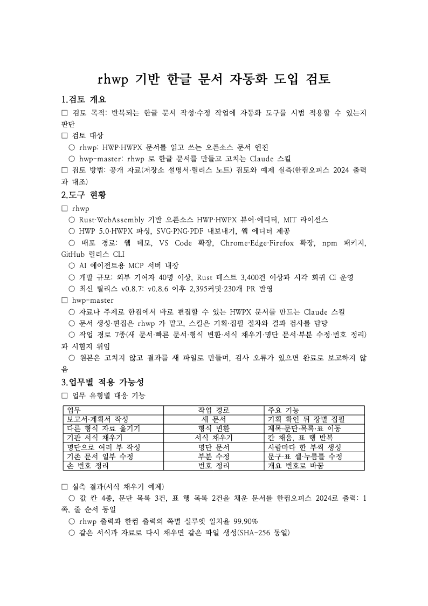

# 개조식 보고서 예제 — 「rhwp 기반 한글 문서 자동화 도입 검토」

Default 라우트(기획 확인 → 단위 집필 → 빌드·검사)로 만든 2쪽 개조식 보고서입니다. 샘플 보고서를 만들어 달라는
요청에 에이전트가 주제·독자·분량을 정한 기획(`doc_spec.md`)을 먼저 보여 주고, 확인을 받은 뒤 장별 원고를 쓰고 빌드했습니다.



| 파일 | 내용 | SHA-256 |
|---|---|---|
| `doc_spec.md` | 기획 — 독자·목적·분량·장 구성·근거 자료·확인 필요 사항 (사용자 확인을 받은 판) | |
| `spec_lock.json` | 기획 잠금 — 문서 규칙(`gaejosik`), 최대 쪽수 3 | |
| `outline.json` | 장 구성과 장별 근거 자료 | |
| `units/U01–U05.json` | 장별 HDS 원고 (제목·문단·표) | |
| `report.hwpx` | 결과 — 한컴오피스에서 바로 편집할 수 있는 HWPX (2쪽, 표 1개) | `52b636829d40c5f7601adbf1a4b6f79782394b42222ac02491d35b3c3b2fb1c0` |
| `hancom/report-2024.pdf` | `report.hwpx` 를 한컴오피스 2024 로 PDF 출력 (2쪽) | `975961846f9e20caf25053890b5474ecfe9372cccf9c699498688583c218dbd5` |
| `tsv/report_native_silhouette.tsv` | rhwp 출력과 한컴 PDF 의 쪽별 실루엣 일치율 (1쪽 98.55%, 2쪽 98.94%) | |
| `png/page1.png`, `png/page2.png` | rhwp 미리보기 | |

근거 자료(`outline.json` 의 `sources/…`)는 2026-11-02 당시의 rhwp·hwp-master README, 사용 설명서, rhwp v0.8.7
릴리스 노트, 서식 채우기 예제 실측 사본이라 여기에는 넣지 않았습니다. 빌드에는 단위 원고만 쓰입니다.

## 재현

rhwp `devel` `ea86816b`(0.9.0) 에서 같은 원고는 macOS·Linux 모두 같은 바이트의 HWPX 를 만듭니다(2026-11-03 확인).
rhwp 커밋이 바뀌면 SHA-256 도 바뀔 수 있습니다.

```bash
P=$(python3 skills/hwp-master/scripts/project_manager.py init report-demo | tail -1)
cp examples/report/{doc_spec.md,outline.json,spec_lock.json} $P/
cp examples/report/units/*.json $P/units/
python3 skills/hwp-master/scripts/build.py $P
shasum -a 256 $P/exports/*.hwpx      # Linux 는 sha256sum
```

## 한컴 출력과 다른 점

두 쪽 모두 본문 줄의 위치는 한컴 출력과 겹칩니다. 다른 곳은 장 제목(`1.검토 개요` 따위)의 번호와 제목 글 사이
간격입니다. 한컴은 번호 뒤를 더 띄우는데 rhwp 미리보기는 붙여 그립니다. HWPX 를 한컴에서 열면 한컴 간격으로 보입니다.
rhwp 쪽 수정은 [edwardkim/rhwp#8433](https://github.com/edwardkim/rhwp/pull/8433)(개요 번호와 본문 사이 거리)과
[#8429](https://github.com/edwardkim/rhwp/pull/8429)(scaffold 의 측정하지 않은 줄 정보)로 제출돼 있고, 두 변경을 넣은
빌드로는 같은 원고의 실루엣 일치율이 두 쪽 모두 99.97% 였습니다. 두 PR 이 반영되면 이 예제를 다시 만듭니다.

측정: 2026-11-03, `scripts/visual_sweep.py --silhouette-only --compat 2024 --dpi 96`(rhwp 저장소, 같은 `ea86816b` 빌드),
rhwp 글꼴 `ttfs/opensource`. 한컴 PDF 는 `report.hwpx` 를 한컴오피스 2024 로 Print 출력한 2쪽입니다.
