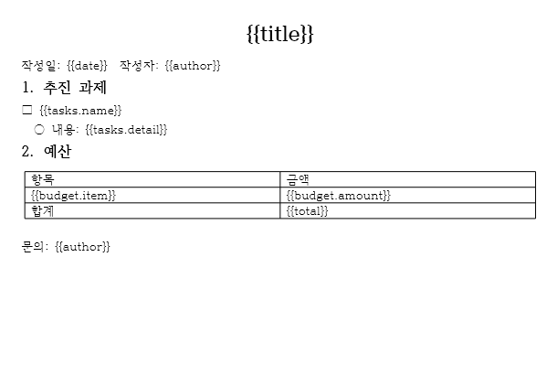
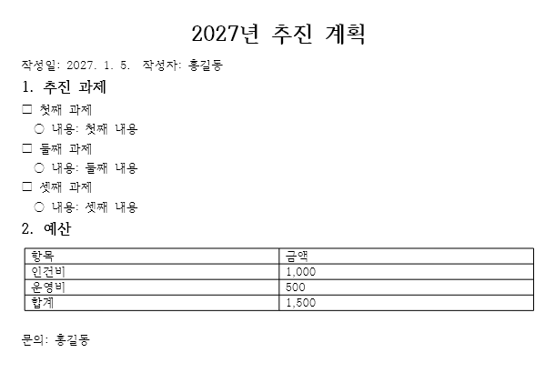

# Template Fill 예제

자리표시(`{{ }}`)를 넣은 서식에 자료 JSON 을 채운 예제입니다. 값 칸은 한 번 채워지고, 문단 목록 `tasks` 는
과제 수만큼 문단이 반복되며, 표 행 목록 `budget` 은 예산 항목 수만큼 행이 늘어납니다.

| 서식 (`form.hwpx`) | 채운 결과 (`filled.hwpx`) |
|---|---|
|  |  |

| 서식의 자리표시 | 종류 | `data.json` 값 |
|---|---|---|
| `{{title}}`, `{{date}}`, `{{author}}`, `{{total}}` | 값 칸 (`{{author}}` 는 두 곳) | 문자열 |
| `{{tasks.name}}`, `{{tasks.detail}}` | 문단 목록 — □·○ 두 문단이 한 건 | 객체 3건 |
| `{{budget.item}}`, `{{budget.amount}}` | 표 행 목록 — 표의 둘째 행이 한 건 | 객체 2건 |

Claude 에게는 이렇게 요청하면 됩니다. 자료가 JSON 이 아니어도(문서·메모) AI 가 값을 뽑아 `data.json` 을 만듭니다.

```
나: examples/template_fill/form.hwpx 서식에 examples/template_fill/data.json 을 채워 줘
```

| 파일 | 내용 | SHA-256 |
|---|---|---|
| `form.hwpx` | 자리표시 서식 (`form.spec.json` 을 `rhwp scaffold` 로 만든 것) — 값 칸 4종, 문단 목록 `tasks`, 표 행 목록 `budget` | `55fe8033a953e58c58f8b9da884a5da4b536b895f0424e59f216d3c02868562c` |
| `data.json` | 채울 자료 (과제 3건, 예산 2행) | |
| `filled.hwpx` | 채운 결과 (rhwp 0.9.0) | `95f3c32d532f9ca223f51f52e827d5718812aa86a16ee61d36d71bd0153eb709` |
| `hancom/filled-2024.pdf` | `filled.hwpx` 를 한컴오피스 2024 로 PDF 출력 (1쪽) | `8696ed76e2539e615ae1178750e656b1ae0066c9f2d51342060e192708e2d043` |
| `tsv/filled_native_silhouette.tsv` | rhwp Native 출력과 한컴 PDF 의 쪽별 실루엣 일치율 (1쪽 99.90%) | |
| `png/form.png`, `png/filled.png` | rhwp 미리보기 (96 dpi, 위쪽만 자름) | |

## 재현

```bash
P=$(python3 skills/hwp-master/scripts/project_manager.py init tf-demo | tail -1)   # projects/tf-demo_<날짜>
cp examples/template_fill/form.hwpx examples/template_fill/data.json $P/sources/
python3 skills/hwp-master/scripts/template_fill.py fill $P sources/form.hwpx --data sources/data.json
#   → exports/form_template_<시각>.hwpx, validation/template_<시각>.json
```

rhwp 0.9.0 에서는 `filled.hwpx` 와 같은 SHA-256 이 나옵니다. rhwp 0.9.1(`ea9f0bb`)에서는 바이트가 달라지지만
(`0c7fb15a…`) `export-text` 텍스트는 `filled.hwpx` 와 같고 검사 결과도 통과입니다(2026-11-28 확인).
`filled.hwpx` 는 한컴 PDF 와 짝을 맞추려고 0.9.0 판을 그대로 둡니다.

측정: 2026-11-02, `scripts/visual_sweep.py --silhouette-only --compat 2024 --dpi 96`(rhwp 저장소),
rhwp 글꼴 `ttfs/opensource`. 한컴 PDF 텍스트(`pdftotext -layout`)의 줄 순서가 rhwp `export-text` 와 같다.
